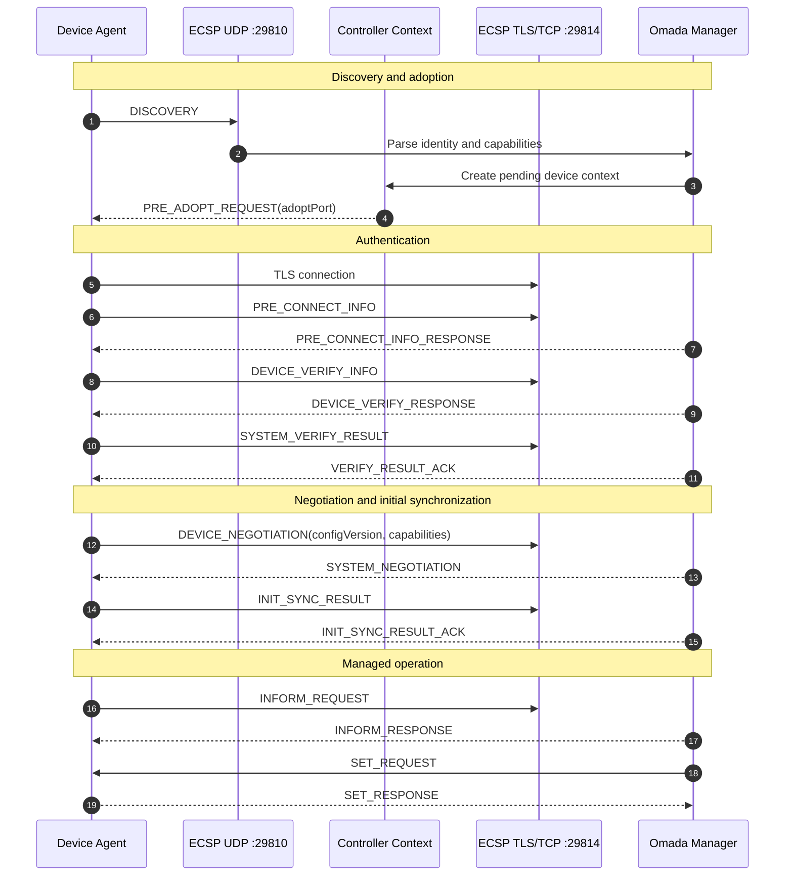
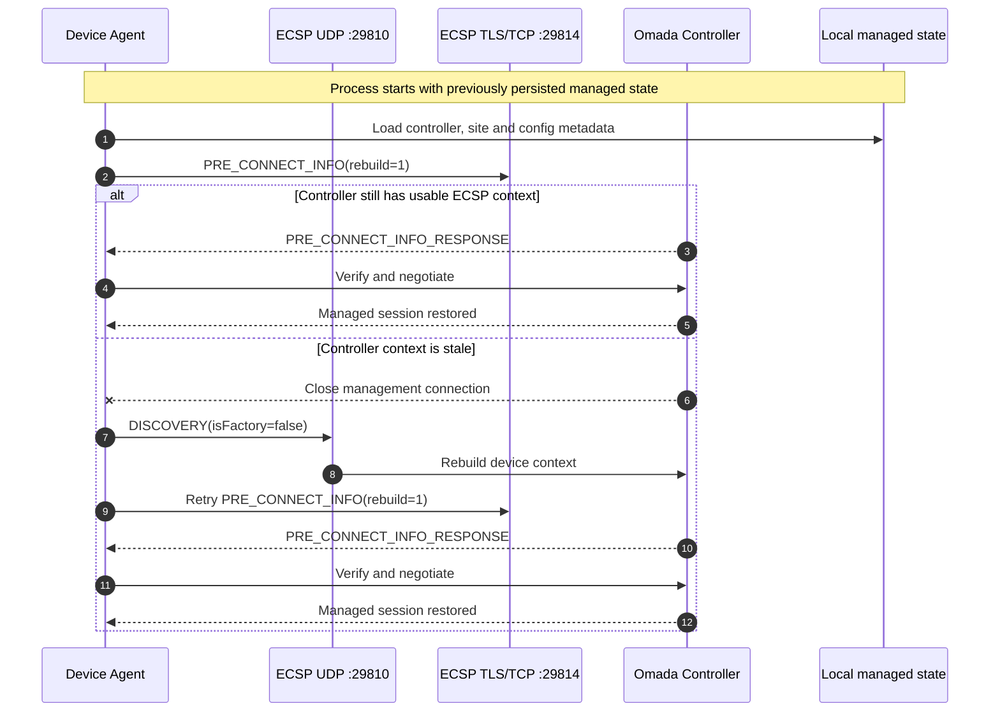

# Open Omada Device Agent

> Experimental, unofficial device-side implementation of the Omada ECSP protocol.

**Open Omada Device Agent** is an interoperability and protocol-research project
that implements enough of the device side of Omada ECSP to discover, adopt,
authenticate, synchronize, reconnect, and report a reference access point to an
Omada Network Application controller.

The project is maintained under the **Open Omada** organization and is intended
as a foundation for open device integrations, protocol documentation, test
fixtures, and future device adapters.

> [!WARNING]
> This project is **alpha software**. It is not affiliated with, endorsed by, or
> sponsored by TP-Link or Omada. Do not use it on production networks unless you
> understand the protocol and operational risks.

## Current status

The reference implementation targets the ECSP V2 family. It was first built
against Omada Network Application `6.2.14.11` with an EAP110 v4-compatible AP
profile, and has since been validated against Controller `6.3.0.111` with a
dual-band Wi-Fi 6 OpenWrt AP advertised as an EAP model of the same generation
(`OMADA_DEVICE_MODEL`, see the
[configuration reference](docs/configuration.md#device-identity)).

| Area | Status |
| --- | --- |
| UDP discovery / site-scoped discovery | ✅ Working |
| `PRE_ADOPT_REQUEST` handling | ✅ Working |
| TLS management channel | ✅ Working |
| Legacy V2 mutual Device Account verification | ✅ Working |
| Device/system negotiation | ✅ Working |
| Initial sync | ✅ Working |
| Managed state persistence | ✅ Working |
| Restart without another manual Adopt | ✅ Working |
| Managed rediscovery / stale-context recovery | ✅ Working |
| Periodic device informs | ✅ Working; telemetry in the formats Controller 6.3 parses |
| Device IP shown in the controller | ✅ `OMADA_DEVICE_IP=local` reports the address used to reach the controller (IPv4 or IPv6) |
| Radio capability advertisement | ✅ From `iw list`: channels, widths up to 160 MHz, antennas, wireless modes; DFS channels when the regulatory domain supports radar detection |
| `SET_REQUEST` acknowledgement | 🟡 Partial; rejects unsupported keys |
| Max clients, RSSI threshold, U-APSD | 🟡 Per radio from Wireless → Advanced; OFDMA is always on (checkbox hidden; OpenWrt has no switch for it) |
| Network Check (Tools) | 🟡 Ping, Traceroute, DNS Lookup and ARP Table run on the AP with BusyBox; output streams into the controller's Device Output |
| Interference Detection scan | 🟡 On-demand neighbour scan with `iw`; shows in Statistics → Interference Detection |
| Radio/SSID configuration | 🟡 OpenWrt UCI adapter: SSIDs, wireless mode, channel, width (20–160 MHz), Tx power up to the radio's limit, Auto channel range, Wi-Fi country (`OMADA_WIFI_COUNTRY`) |
| SSID VLAN configuration | 🟡 Opt-in OpenWrt UCI adapter |
| Management VLAN configuration | 🟡 Opt-in OpenWrt UCI adapter |
| Client IP/name reporting | 🟡 hostapd association is the source of truth; IPs and names come from DHCP leases, openNDS and passive DHCP/ARP/NDP/mDNS listening on the bridges |
| OpenWrt radio/SSID telemetry | 🟡 Live channel, width and mode, per-SSID stats and channel utilisation via `ubus`, hostapd and `iw` |
| Client operations and rate limits | 🟡 Optional `ubus`/nftables adapters |
| LED enable/disable/locate | 🟡 Optional sysfs adapter; state survives Locate and agent restarts |
| FORGET / forget-no-reset response | ✅ Working |
| Captive portal sessions/enforcement | 🟡 openNDS on a routed guest network; controller built-in portal and External Portal redirects, free-policy walled garden, session length and client auth state are wired; guest logout is not |
| Portal RADIUS authentication | 🟡 Library support; not wired to HTTP portal flow |
| `GET_REQUEST` | 🟡 Defensive unsupported-key responses |
| Notify families | 🟡 Defensive unsupported replies |
| Report family | 🚧 Envelope and protobuf DTOs identified; `reportData` serializer not implemented |
| Switch/gateway/OLT device profiles | 🚧 Planned |

The capability table is intentionally conservative. The agent advertises only
components whose lifecycle is currently understood well enough not to mislead
the controller. On OpenWrt, `OMADA_MAX_SSIDS` is treated as a manual upper
bound; when `iw list` reports no valid multi-interface combinations, the agent
caps the advertised and applied SSID count to one AP interface so hostapd does
not fail the whole radio.

## Protocol at a glance

The most useful way to read ECSP is as a sequence of exchanges between the
device and the controller. The diagram below shows the currently implemented V2
path from first discovery to managed operation.



Static software relationships are documented separately with architecture
diagrams. See [docs/architecture.md](docs/architecture.md),
[docs/protocol-overview.md](docs/protocol-overview.md), and
[docs/device-lifecycle.md](docs/device-lifecycle.md) for the complete model.

## Quick start

### 1. Create a virtual environment

```bash
python3 -m venv .venv
source .venv/bin/activate
python -m pip install --upgrade pip
python -m pip install -e .
```

For development:

```bash
python -m pip install -e '.[dev]'
```

### 2. Configure the controller

```bash
cp .env.example .env
```

Edit `.env` and set at least:

```dotenv
OMADA_CONTROLLER_HOST=omada-controller.example.net
OMADA_CONTROLLER_ID=0123456789abcdef0123456789abcdef
OMADA_SITE_ID=0123456789abcdef01234567
OMADA_DEVICE_PASSWORD=your-device-account-password
```

The Device Account password is read only from the environment and is **never
written to the managed-state file**.

For the **first adoption** of a factory-state agent, the controller expects the
factory credentials `admin` / `admin`; switch to the site Device Account password
after the device is Connected. See
[Device Account authentication](docs/configuration.md#device-account-authentication).

### 3. Run the agent

```bash
open-omada-agent --dump-tx
```

Equivalent development entry point:

```bash
python -m open_omada_device_agent --dump-tx
```

The legacy launcher is retained for migration:

```bash
python agent.py --dump-tx
```

To start the agent at boot on OpenWrt (with restart after a crash), install
the procd service from the checkout that holds your `.env`:

```bash
cp scripts/openwrt/open-omada-agent.init /etc/init.d/open-omada-agent
chmod +x /etc/init.d/open-omada-agent
/etc/init.d/open-omada-agent enable
/etc/init.d/open-omada-agent start
```

Edit `AGENT_DIR` and `AGENT_ARGS` at the top of the script if your checkout is
not `/root/open-omada-device-agent`. The service starts the agent with
`--workdir "$AGENT_DIR"`, which loads `.env` and the managed state file from
that folder. Output goes to the system log; read it with
`logread -e open_omada`. Add `--debug` to `AGENT_ARGS` only while
troubleshooting. Restart with `/etc/init.d/open-omada-agent restart`.

## Runtime behavior

A first-time device follows the discovery and adoption path. After successful
initial synchronization, the agent persists only non-secret routing and config
metadata. A later process restart attempts a managed reconnect directly.

If the controller has expired transient ECSP state, repeated direct reconnects
are stopped and the agent performs **managed rediscovery** with
`isFactory=false`, allowing the controller to rebuild the device-side context
without requiring another manual Adopt action in the normal recovery case.



## OpenWrt captive portal

On OpenWrt, captive portal enforcement should use `openNDS` instead of the
agent's older nftables-only fallback. OpenWrt 25 snapshots use `apk`:

```bash
apk update
apk add opennds dnsmasq-full conntrack
```

Older OpenWrt releases may still use `opkg`:

```bash
opkg update
opkg install opennds dnsmasq-full conntrack
```

The agent auto-detects portal capability when `opennds` and `ndsctl` are
available. If `OMADA_CAP_PORTAL=false` is set in `.env`, that explicit override
disables portal acceptance.

At startup on OpenWrt, the agent also applies an idempotent platform bootstrap:
it sets `bridge_empty=1` on the configured LAN bridge so Wi-Fi-only devices can
create `br-lan`, reloads network/Wi-Fi when that prerequisite changed, enables
openNDS on `OMADA_OPENNDS_INTERFACE` (default: the LAN bridge) when installed, and disables openNDS preemptive
authentication so clients follow the Omada ThemeSpec redirect. It also sets
`gatewayfqdn=disable` so the first openNDS preauth redirect uses the gateway IP
instead of the default `status.client` name; this keeps macOS/iOS captive checks
working when a client has custom DNS such as `8.8.8.8`. Lab WAN access for
SSH/LuCI is available only through `OMADA_OPENWRT_ENABLE_WAN_MANAGEMENT=true`.

### Portal on an AP that is not the router

openNDS treats every device on its interface as a portal client, including
the upstream router. On an AP whose uplink is on the LAN bridge, openNDS on
that bridge cuts the AP off from the gateway and the controller, so the agent
refuses to start openNDS on the interface that holds the default route.

Put portal SSIDs on a routed guest network instead: a UCI network with its own
subnet, DHCP and NAT. Set `OMADA_PORTAL_NETWORK` to that network and
`OMADA_OPENNDS_INTERFACE` to its bridge. The agent attaches portal SSIDs to the
guest network and starts openNDS when the first portal SSID arrives. See
[Captive portal on OpenWrt](docs/configuration.md#captive-portal-on-openwrt)
for a worked example.

Validated behavior today:

- openNDS captures unauthenticated WLAN clients on OpenWrt.
- Omada `portalFreePolicyConfig` is translated into openNDS walled-garden FQDN
  and preauthenticated IP rules.
- When Omada sends a portal URL through `portalConfigList` or a `/portal/...`
  URL in `portalFreePolicyConfig`, the agent writes an openNDS ThemeSpec that
  redirects the captive browser to that Omada-configured URL instead of the
  stock openNDS splash. For the controller's own login page (`/portal/entry`)
  the redirect appends the query names it reads: `cid`, `ap`, `ssid`, `rid`,
  `t`, `u` and `clientIp`. For an External Portal server it appends
  `clientMac`, `apMac`, `ssidName`, `t`, `radioId`, `site`, and `redirectUrl`,
  matching the TP-Link External Portal contract.
- The login page host (or its IP and port) is reachable before login, so the
  captive browser can load it.
- End to end with Controller 6.3.0.111's built-in portal: a phone on the
  portal SSID gets the login page, taps Log In, and openNDS authenticates it.
- The openNDS adapter disables `allow_preemptive_authentication` and relies on
  the classic HTTP redirect path; this avoids Android CPD/RFC8910 opening a
  generic status page instead of the Omada-configured portal URL.
- The openNDS adapter disables `gatewayfqdn`, so captive clients are redirected
  to the gateway IP and do not need to resolve the local-only `status.client`
  hostname.
- Omada `clientConfig.unauth` and controller logins (`EVENT_PORTAL_AUTH`) are
  translated into `ndsctl auth/deauth`. A login lasts as long as the portal's
  Authentication Timeout.
- When `conntrack` is installed, deauth also clears flows for the client's IP
  so previously authenticated sessions stop immediately.
- `ndsctl json` is merged into Omada client telemetry as portal state. Only
  logged-in clients are reported in `portalAuthClients`.
- Client MACs, AP MACs, ECSP header MACs, `deviceInfo.mainMac`, SSID BSSIDs,
  and portal redirect MAC parameters are serialized in Omada's controller-facing
  format: `AA-BB-CC-DD-EE-FF`.
- The old `inet openomada_portal` nftables fallback is skipped when openNDS is
  present.

Current limitation:

- The agent does not host the external portal UI and does not submit
  `/hotspot/extPortal/auth` itself. The external portal configured in Omada must
  preserve the redirect query parameters and perform Controller authorization.
- Guest logout (the controller's logout domain) is not implemented yet.

### OpenWrt deployment helper

From a development checkout, copy the current source to the Rock Pi OpenWrt
filesystem and restart the agent:

```bash
scripts/deploy-openwrt.sh
```

Useful overrides:

```bash
OPENWRT_HOST=root@172.17.0.4 \
REMOTE_DIR=/mnt/shared/open-omada-device-agent \
AGENT_ARGS="--debug --dump-tx" \
scripts/deploy-openwrt.sh
```

The script syncs the source tree with `tar` over SSH, preserves the remote
`.env`, stops the current `/usr/bin/open-omada-agent` process, starts it again,
and prints the last lines from `/tmp/open-omada-agent.log`.
When the `open-omada-agent` service is installed and enabled, the script
restarts the service instead, so procd does not start a second copy; the
service's own `AGENT_ARGS` apply and the script prints `logread -e open_omada`.

## Documentation

- [Protocol overview](docs/protocol-overview.md)
- [ECSP wire format](docs/ecsp-wire-format.md)
- [Device lifecycle](docs/device-lifecycle.md)
- [Project architecture](docs/architecture.md)
- [Configuration reference](docs/configuration.md)
- [Protocol support matrix](docs/protocol-status.md)
- [Research methodology](docs/research-methodology.md)
- [Development guide](docs/development.md)
- [Security model](SECURITY.md)

## Project layout

The implementation is organized around bounded contexts rather than global
technical layers. ECSP is an inbound anti-corruption layer, OpenWrt is an
outbound adapter, and `bootstrap/` is the composition root. Stable flat modules
remain temporary compatibility façades. See [the architecture guide](docs/architecture.md)
for context APIs, dependency rules, flows, and extension guides.

## Research and provenance

The implementation is based on protocol behavior observed through controlled
lab testing, packet captures, controller logs, and interoperability research.
Documentation distinguishes confirmed wire behavior from assumptions and
incomplete areas where possible.

This repository does **not** include vendor firmware, vendor source code,
decompiled vendor code, certificates, private keys, or proprietary assets.

## Security and responsible use

Use a dedicated lab controller and test network whenever possible. Never commit
`.env`, controller tokens, Device Account passwords, packet captures containing
credentials, or managed-state files from sensitive environments.

See [SECURITY.md](SECURITY.md) before reporting a vulnerability or publishing a
capture that may contain secrets.

## Contributing

Protocol captures, controller-version compatibility reports, tests, and clean
room implementations of additional message families are welcome. Read
[CONTRIBUTING.md](CONTRIBUTING.md) before opening a pull request.

## License

Apache License 2.0. See [LICENSE](LICENSE) and [NOTICE](NOTICE).
